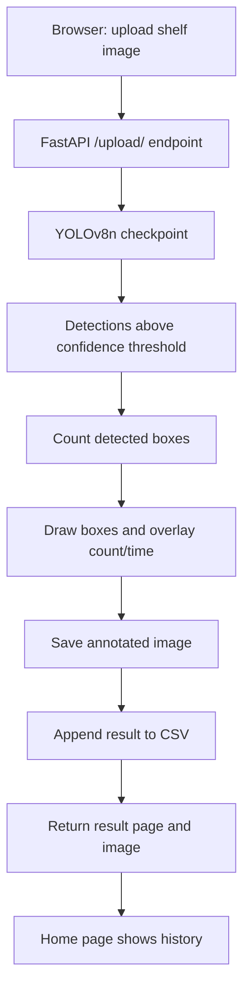

# ShelfSense — Retail Shelf Object Detection & Counting

A computer-vision demo that detects visible products in retail shelf images using a fine-tuned **YOLOv8n** model. A **FastAPI** web application accepts an uploaded image, draws detection boxes, displays the number of detected objects and inference time, and records results in a CSV file.

> **Scope:** This is a single-class object detector for visible shelf items. It does not identify individual SKUs, product names, prices, or stock-keeping-unit IDs, and its count should not be treated as an inventory audit.

## Demo

### Web application


### Example predictions

| Example 1 | Example 2 |
|---|---|
|  |  |
|  |  |

## Results

The following values are the validation metrics documented for the checkpoint's evaluation run. Results can change with the checkpoint, dataset split, image size, and evaluation configuration.

| Metric | Validation result |
|---|---:|
| Precision | 88.35% |
| Recall | 79.67% |
| mAP@50 | 87.63% |
| mAP@50–95 | 54.83% |

- **Precision** measures how many predicted detections are correct.
- **Recall** measures how many ground-truth objects the model detects.
- **mAP@50** is mean average precision at an IoU threshold of 0.50.
- **mAP@50–95** averages mAP over IoU thresholds from 0.50 through 0.95.

### Training and validation plots


| Precision–recall | Precision vs. confidence |
|---|---|
|  |  |

| Recall vs. confidence | F1 vs. confidence |
|---|---|
|  |  |

## Features

- Fine-tuned YOLOv8n model trained on the SKU-110K retail shelf dataset.
- Image upload through a simple browser interface.
- Bounding-box annotations, detected-object count, and per-image processing time.
- CSV history displayed on the home page.
- Training plots and sample predictions for inspection.

## Architecture



### Tech stack

- **Python 3.10** — application runtime
- **Ultralytics YOLOv8 / PyTorch** — object detection
- **FastAPI + Uvicorn** — web application and inference endpoint
- **OpenCV** — image loading and annotation
- **Jinja2 + HTML** — browser interface
- **CSV** — local inference history

## Run locally

### Prerequisites

- Git
- Python 3.10
- Internet access to install dependencies
- A compatible PyTorch build for your machine (CUDA GPU optional)

### 1. Clone the repository

```bash
git clone https://github.com/Htet-ThuAung/sku110k-yolov8-shelf-detector.git
cd sku110k-yolov8-shelf-detector
```

### 2. Create and activate a virtual environment

**Windows (PowerShell or Command Prompt):**

```bat
python -m venv .venv
.venv\Scripts\activate
```

**Linux / macOS:**

```bash
python3 -m venv .venv
source .venv/bin/activate
```

### 3. Install dependencies

```bash
python -m pip install --upgrade pip
python -m pip install -r requirements.txt
```

The provided requirements file pins PyTorch and torchvision CUDA 11.8 wheels for the development environment. If these wheels are incompatible with your operating system or hardware, install a matching PyTorch/torchvision build using the [official PyTorch installation selector](https://pytorch.org/get-started/locally/), then install the remaining dependencies from `requirements.txt` without reinstalling incompatible pinned PyTorch packages.

### 4. Check the model checkpoint

The application expects the trained checkpoint at:

```text
outputs/sku110k_continue/weights/best.pt
```

Make sure this file exists before starting the app. If it is missing from your checkout, obtain the trained checkpoint separately or train the model locally (see [Training](#training)). The model path is currently configured in `src/api.py`.

### 5. Start the application

Run from the repository root:

```bash
python -m uvicorn scripts.main:app --reload
```

Open [http://127.0.0.1:8000](http://127.0.0.1:8000) in your browser. Upload a shelf image to see the annotated result, detected-object count, and processing time.

### Routes

| Route | Method | Purpose |
|---|---|---|
| `/` | GET | Upload page and saved inference history |
| `/upload/` | POST | Accept an image and run detection |
| `/static/annotated/{filename}` | GET | Serve a saved annotated image |

## Automated tests

The API tests use a fake YOLO model, so they do not need the trained checkpoint or a GPU.

Install the development test dependencies in your active virtual environment:

```bash
python -m pip install -r requirements-dev.txt
python -m pytest -q
```

The suite covers unsupported file types, empty uploads, invalid image bytes, successful inference output and saved artifacts, zero detections, and model failures. It also checks that rejected uploads do not invoke the model and that internal exception details are not returned to clients.

These are automated regression tests, not a claim that the full app has been run against a fresh installation or a real trained checkpoint.

## Reproducible inference benchmark

ShelfSense includes a benchmark script that measures per-image YOLO prediction latency and writes a Markdown report, JSON summary, and per-image CSV. It records the model checkpoint SHA-256, each tested image's SHA-256, Git revision when available, package versions, operating system, CPU/GPU details, image size, confidence threshold, warm-up count, and measured run count.

The benchmark uses a sorted, repeatable selection of up to 50 readable images by default, which avoids loading an entire large dataset into memory. Use `--max-images 0` to include every readable image. The report measures the Ultralytics prediction call (preprocessing, inference, and postprocessing); it excludes model loading, upload/network time, drawing annotations, writing images, and CSV persistence. GPU calls are synchronized for more meaningful timing when CUDA is selected.

### Run it

Use the same checkpoint and a fixed set of test images for comparisons. The source can be one image or a directory searched recursively.

**Windows (PowerShell or Command Prompt):**

```bat
python scripts/benchmark.py --model outputs/sku110k_continue/weights/best.pt --source datasets/SKU-110K --device 0 --imgsz 640 --conf 0.4 --warmup 5 --runs 30 --max-images 50 --output-dir reports/benchmark
```

**CPU-only run:**

```bash
python scripts/benchmark.py --model outputs/sku110k_continue/weights/best.pt --source path/to/fixed-test-images --device cpu --imgsz 640 --conf 0.4 --warmup 5 --runs 30 --max-images 50 --output-dir reports/benchmark-cpu
```

Replace the source path with a directory that exists in your local dataset. Keep the source images, checkpoint, device, image size, confidence threshold, warm-up count, and run count the same when comparing runs.

The output directory contains:

- `benchmark_report.md` — human-readable results and environment details.
- `benchmark_summary.json` — machine-readable settings, aggregate latency, environment, and artifact hashes.
- `benchmark_per_image.csv` — latency statistics and input-image hashes for each tested image.

The report provides mean, median, 95th-percentile, minimum and maximum latency, plus a sequential throughput estimate (1000 divided by mean latency). This is a local single-image benchmark, **not** an end-to-end FastAPI benchmark or a concurrent-user load test. Do not publish performance values until you have run the script on the stated hardware; speed results vary by device and environment.

## Outputs and generated files

The application creates the following paths under `outputs/inference_api_results/`:

- Uploaded input images
- `annotated/` — annotated output images
- `csvfile/results.csv` — filename, object count, processing duration, and image path

These are local demo outputs. Avoid uploading private or sensitive images, and review generated files before committing them to Git.

## Model and training

- **Model:** YOLOv8n
- **Dataset:** SKU-110K
- **Task:** Single-class object detection (class name: `object`)
- **Inference confidence threshold:** 0.40
- **Documented training configuration:** 20 epochs across initial and continued training runs; batch size 2
- **Development hardware:** ASUS TUF FX505DD

The dataset is not bundled with the repository. The configuration in `configs/sku110k.yaml` expects a local dataset under `datasets/SKU-110K`, with train, validation, and test image lists referenced by the YAML file.

Example training command:

```bash
python scripts/train.py --epochs 10 --batch 2 --imgsz 640 --name sku110k_run
```

Adjust the batch size and other options to suit your hardware. Training requires the dataset to be prepared in the configured layout.

## Repository structure

```text
.
├── configs/
│   └── sku110k.yaml              # Dataset configuration
├── data/
│   └── download_sku110k.py       # Dataset download helper
├── notebooks/
│   └── sku110k_demo.ipynb        # Notebook walkthrough
├── outputs/
│   ├── inference_api_results/    # Runtime outputs (created by the app)
│   ├── shelf-detection.gif       # Demo animation
│   └── sku110k_continue/         # Expected trained checkpoint location
├── results/                      # Evaluation plots
├── scripts/
│   ├── main.py                   # FastAPI entry point
│   ├── train.py                  # Training CLI
│   ├── infer_and_count.py        # Command-line inference
│   └── filter_corrupt_image.py
├── src/
│   ├── api.py                    # Upload route and inference logic
│   ├── counting.py               # Detection counting helper
│   ├── detect.py
│   └── train.py                  # Training implementation
├── templates/
│   └── index.html                # Upload form and history page
├── requirements.txt
└── README.md
```

## Known limitations

- **No SKU recognition:** detections belong to one generic class; the app cannot tell one product type or SKU from another.
- **Counting is approximate:** occlusion, tightly packed products, reflections, unusual packaging, image blur, and camera angle can cause missed or duplicate detections.
- **Confidence threshold affects results:** the web app uses 0.40; changing it can change both the count and precision/recall trade-off.
- **Validation metrics are not a business guarantee:** the reported scores describe a particular evaluation run and do not establish performance for every store, camera, or lighting condition.
- **Not production-hardened:** basic extension, image-decoding, and 10 MB upload checks plus generic error responses are implemented, but the app still lacks authentication, rate limiting, monitoring, and broader security review.
- **Local persistence only:** images and history are stored on disk and in CSV; there is no database, multi-user access control, or cloud storage.
- **Latency is environment-dependent:** the displayed time is measured around model inference in the application and should not be interpreted as an end-to-end service benchmark. Hardware, image dimensions, and device selection affect timing.
- **Reproducibility depends on artifacts:** the dataset is not included. Ensure the trained checkpoint exists at the expected path, and retain the dataset split and training configuration if reproducing the reported metrics.

## Possible next steps

- Add automated tests for counting and API behavior.
- Add file type/size validation and safer error responses.
- Benchmark inference on a documented CPU/GPU and image size.
- Add Docker packaging and a clean-clone smoke test.
- Evaluate on a clearly documented held-out test set.
- Explore tracking or SKU-level classification as separate extensions.

## Author

**Htet Thu Aung**

- [LinkedIn](https://www.linkedin.com/in/htetthuaung/)
- Email: [htetthuaung.engr@gmail.com](mailto:htetthuaung.engr@gmail.com)
