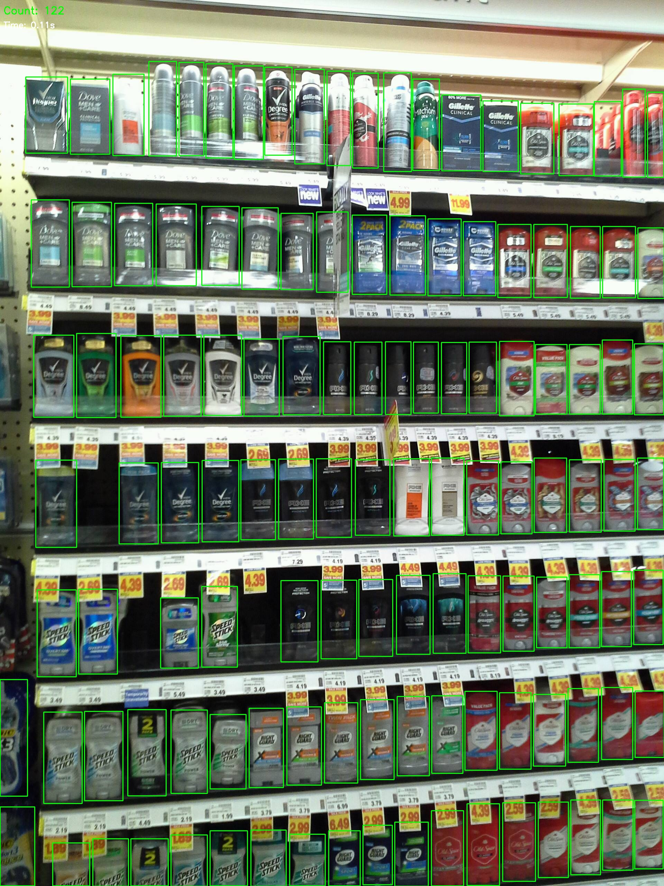
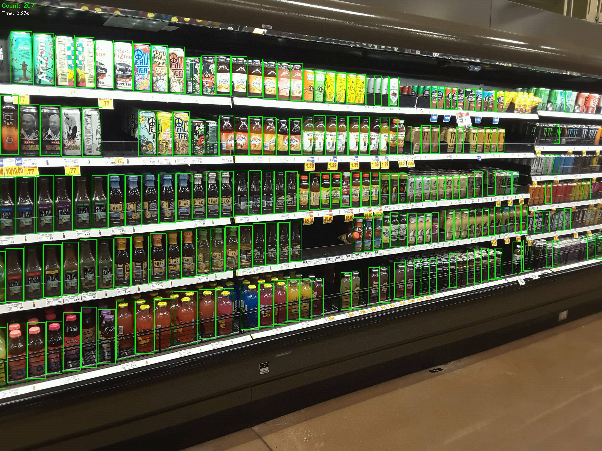
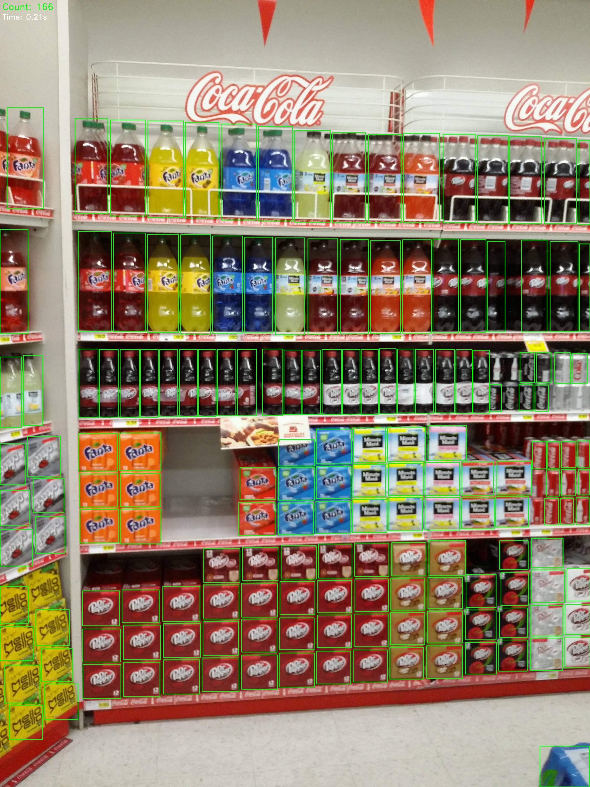
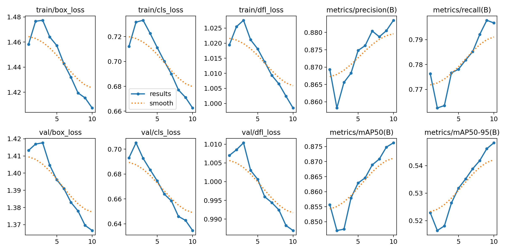
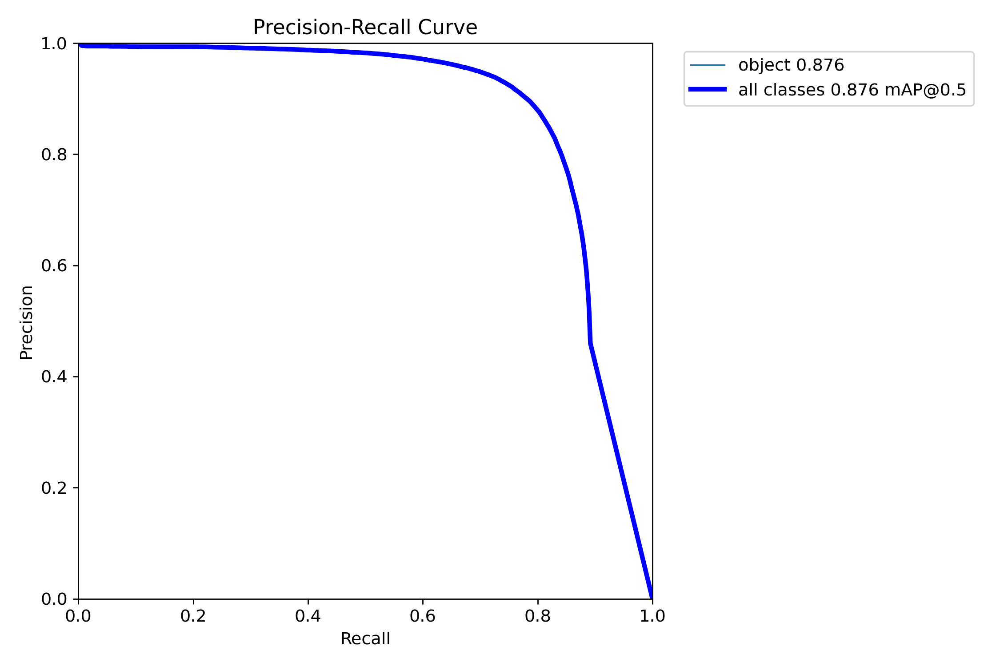
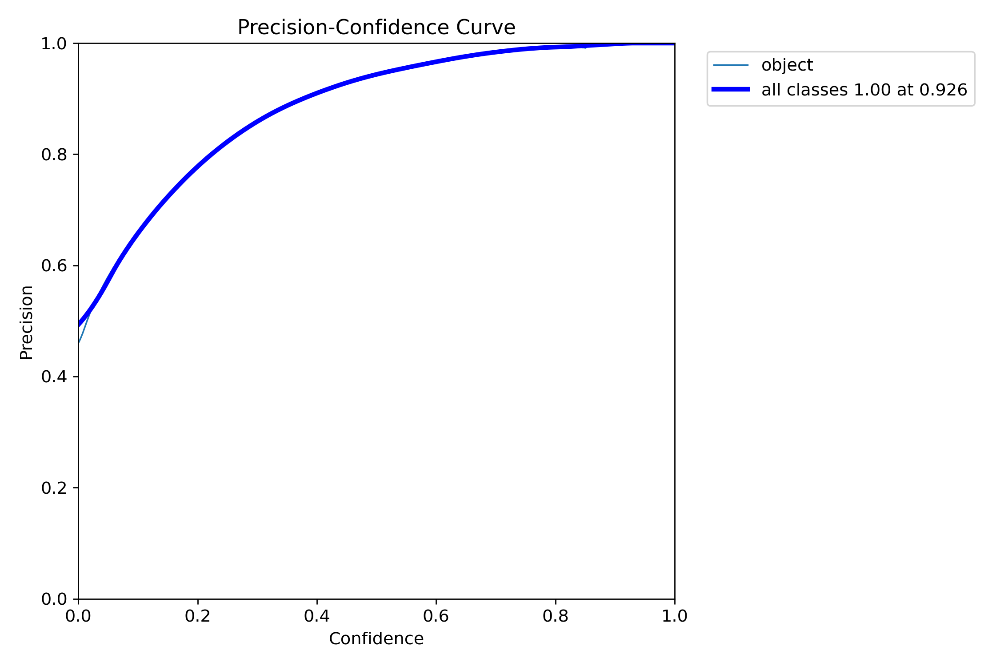
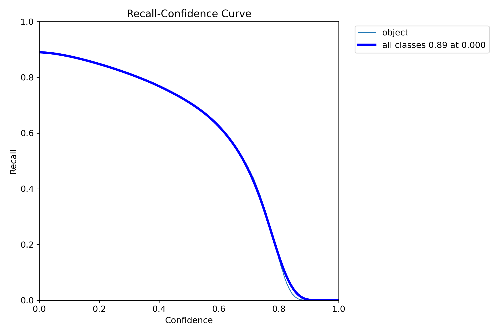
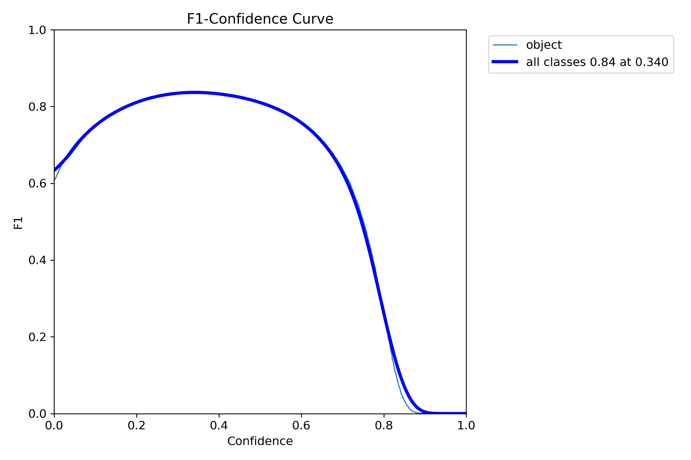
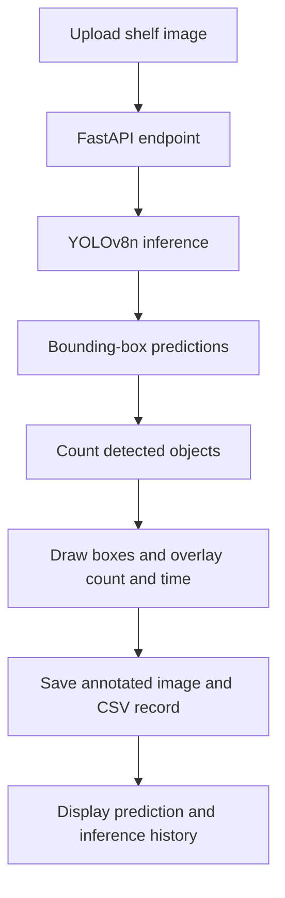

# SKU-110K Shelf Detector — YOLOv8 + FastAPI

A computer vision application that detects and counts products on retail shelf images using a fine-tuned YOLOv8n model. The FastAPI web app lets users upload an image, inspect bounding-box detections, view the predicted object count and inference time, and revisit previous results.

## Highlights

- Fine-tuned YOLOv8n on the SKU-110K retail shelf dataset
- Upload images through a FastAPI web interface
- Draw bounding boxes and calculate the detected-object count
- Display inference time and detection count
- Save inference metadata to CSV and show previous results on the homepage
- Include training and validation plots for model evaluation

## Demo

### Web application


### Example predictions

| Example 1 | Example 2 |
|---|---|
|  |  |
|  |  |

## Model and evaluation

- **Model:** YOLOv8n
- **Dataset:** SKU-110K
- **Task:** Single-class product/object detection
- **Training configuration:** 20 epochs across the initial and continued training runs; batch size 2
- **Training hardware:** ASUS TUF FX505DD
- **Inference confidence threshold in the web app:** 0.40

The following validation metrics are from the evaluation run represented by the plots below. Metrics can vary by checkpoint and validation run.

| Metric | Validation score |
|---|---:|
| Precision | 88.35% |
| Recall | 79.67% |
| mAP@50 | 87.63% |
| mAP@50–95 | 54.83% |

- **Precision:** Fraction of predicted detections that are correct.
- **Recall:** Fraction of ground-truth objects detected by the model.
- **mAP@50:** Mean average precision at an intersection-over-union (IoU) threshold of 0.50.
- **mAP@50–95:** Mean average precision averaged over IoU thresholds from 0.50 to 0.95.

### Training results



### Precision–recall curve



### Precision vs. confidence threshold



### Recall vs. confidence threshold



### F1 score vs. confidence threshold



## How the application works



## Tech stack

- **Python** — application and inference logic
- **Ultralytics YOLOv8 / PyTorch** — object detection
- **FastAPI + Uvicorn** — web application and API
- **OpenCV** — image processing and bounding-box annotation
- **Jinja2 + HTML** — upload form and inference history
- **CSV** — simple inference-result logging

## Run locally

### Prerequisites

- Git
- Python 3.10
- A compatible PyTorch installation for your CPU/GPU environment

### 1. Clone the repository

```bash
git clone https://github.com/Htet-ThuAung/sku110k-yolov8-shelf-detector.git
cd sku110k-yolov8-shelf-detector
```

### 2. Create and activate a virtual environment (Windows)

```bat
python -m venv .venv
.venv\Scripts\activate
```

### 3. Install dependencies

```bash
python -m pip install --upgrade pip
pip install -r requirements.txt
```

The requirements file pins PyTorch/CUDA-related packages for the development environment. If pip cannot resolve the pinned PyTorch packages on your machine, install a compatible PyTorch build for your hardware from the [official PyTorch installation guide](https://pytorch.org/get-started/locally/) and then install the remaining project dependencies.

### 4. Check the trained model checkpoint

The application loads the trained weights from:

```text
outputs/sku110k_continue/weights/best.pt
```

Make sure this file exists before starting the application. The model-loading path is configured in `src/api.py`.

### 5. Start the web app

Run this command from the repository root:

```bash
python -m uvicorn scripts.main:app --reload
```

Open [http://127.0.0.1:8000](http://127.0.0.1:8000) in your browser, upload a shelf image, and inspect the detection results.

> The application writes uploaded images, annotated images, and inference records under `outputs/inference_api_results/`. Avoid committing personal or sensitive images from this directory.

## Repository structure

```text
sku110k-yolov8-shelf-detector/
├── configs/
│   └── sku110k.yaml          # Dataset configuration
├── data/
│   └── download_sku110k.py   # Dataset download helper
├── notebooks/
│   └── sku110k_demo.ipynb    # Notebook walkthrough
├── outputs/
│   ├── inference_api_results/
│   │   ├── annotated/        # Saved annotated predictions
│   │   └── csvfile/          # Inference history
│   ├── shelf-detection.gif   # Application demo
│   └── sku110k_continue/     # Continued training output/checkpoint
├── results/                  # Model evaluation plots
├── scripts/
│   ├── main.py               # FastAPI application entry point
│   ├── train.py              # Training CLI
│   ├── infer_and_count.py    # Command-line inference
│   └── filter_corrupt_image.py
├── src/
│   ├── api.py                # Upload and inference endpoint
│   ├── counting.py           # Detection counting logic
│   ├── detect.py
│   └── train.py              # Training implementation
├── templates/
│   └── index.html            # Upload form and history page
├── requirements.txt
└── README.md
```

The dataset directory is not included in Git. Prepare the SKU-110K dataset locally according to `configs/sku110k.yaml` before running training.

## Training

The training CLI defaults to 10 epochs, batch size 2, image size 640, and the dataset config `configs/sku110k.yaml`. For example:

```bash
python scripts/train.py --epochs 10 --batch 2 --imgsz 640 --name sku110k_run
```

Adjust these options to match your hardware. Training requires the dataset to be downloaded and prepared in the layout referenced by the YAML configuration.

## Current scope and possible next steps

- Improve evaluation with a clearly documented held-out test set
- Add automated tests for counting and API behavior
- Add containerized deployment after the local setup is reproducible

## Author

**Htet Thu Aung**

- [LinkedIn](https://www.linkedin.com/in/htetthuaung/)
- Email: [htetthuaung.engr@gmail.com](mailto:htetthuaung.engr@gmail.com)
